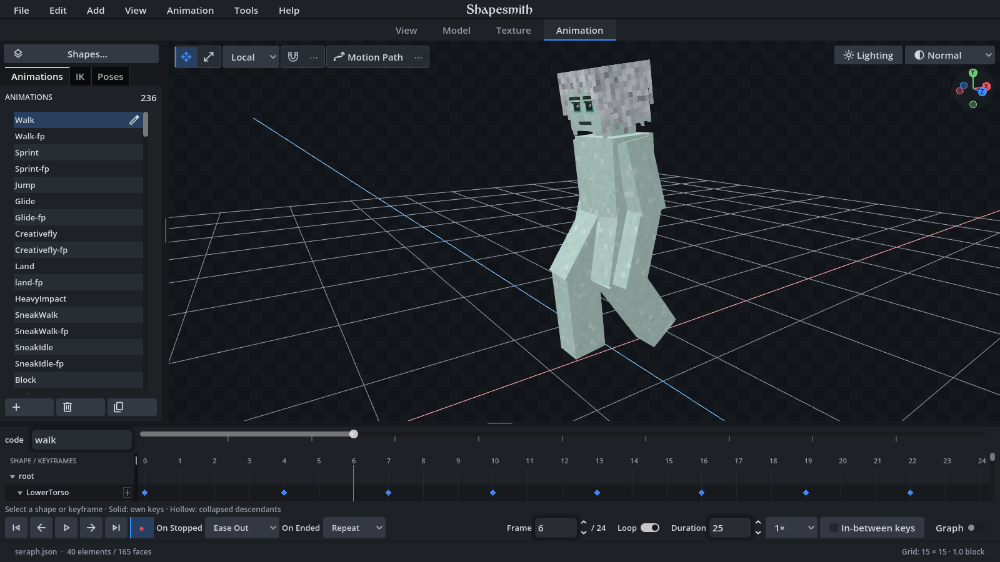

# ShapeSmith

A desktop editor for Vintage Story shapes\
Build models, texture them and animate them, then export files.\
Made with Godot 4.7 mono.

## Features

**Modelling**
- Cuboid hierarchy with an outliner, multi-select, grouping, locking and hiding
- Move, rotate, resize, scale and pivot gizmos, with snapping
- Attachment points and step parents
- Show other shapes alongside yours: a rider on a mount, armour on a body

**Texturing**
- Per-face textures, UV editing with multi-face selection, box unwrap and texel density
- Texture manager with overlays and blend modes
- A Normal render mode that matches the game's shading, plus lighting controls

**Animation**
- Dope sheet, keyframe inspector and graph editor with eased and Bézier curves
- Pose library, mirroring and in-betweens
- IK chains for arms, legs, tails and aiming
- Motion paths and ghost poses

**Files**
- Opens and saves Vintage Story shape JSON; working files keep your curves and IK
- Exports clean game files: curves and IK become ordinary keys, kept to the few the game needs
- Imports glTF and FBX models, and other shapes

**Other**
- A command palette (Ctrl+Shift+P)
- Undo and redo
- Themes
- User guide (Help → User Guide)

## Running it

Open `project.godot` in [Godot 4.7](https://godotengine.org/download) and press
F5.\
Point **File → Configure Asset Paths…** at your Vintage Story `assets`
folder so game textures load.

## Documentation

See the [user guide](docs/user-guide.md). Bundled fonts and icons are listed in
[third-party assets](docs/third-party-assets.md).
